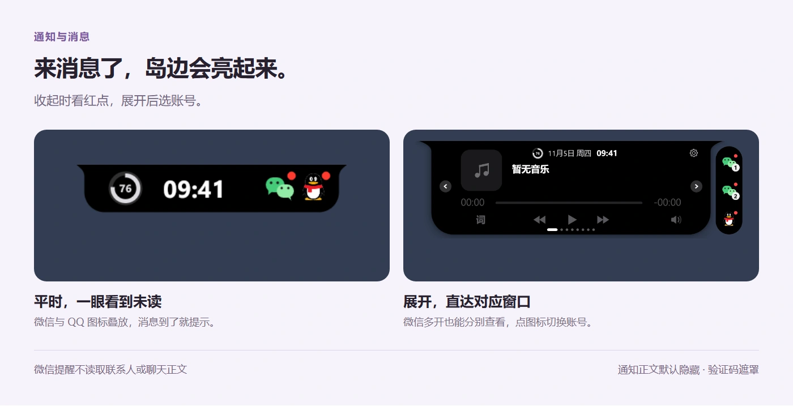
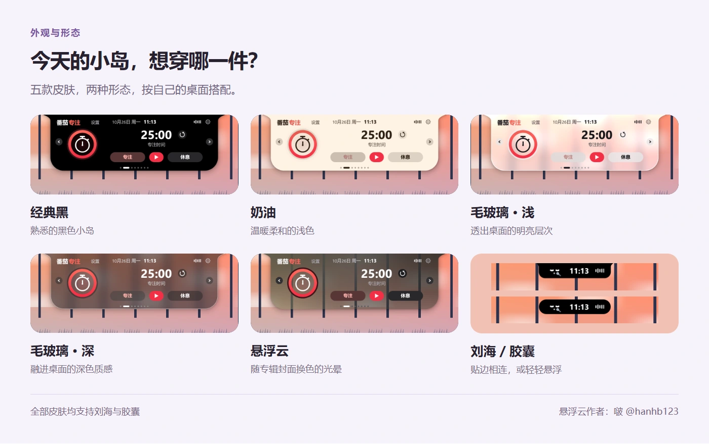
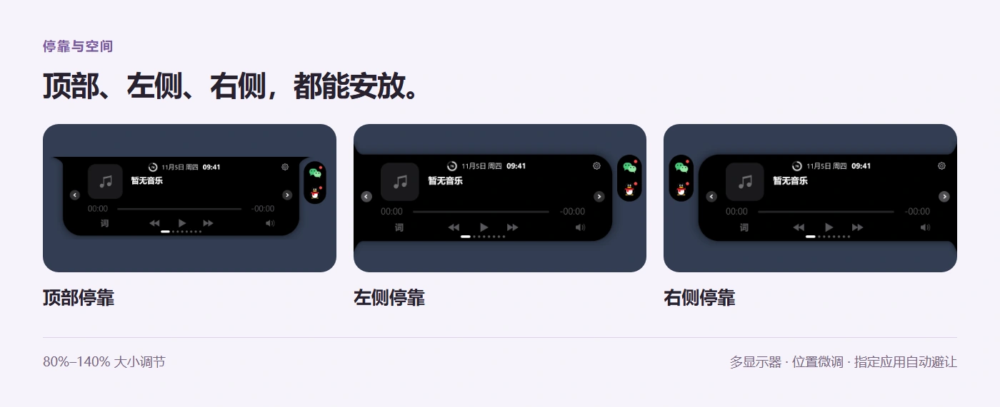
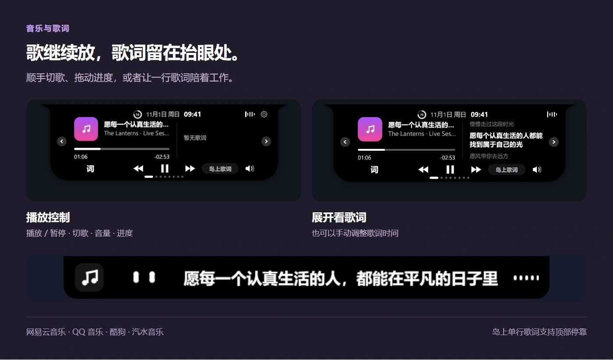
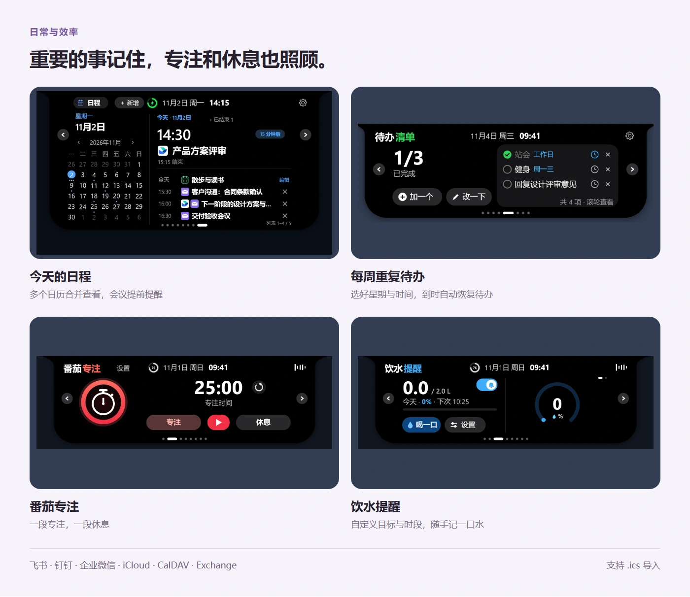
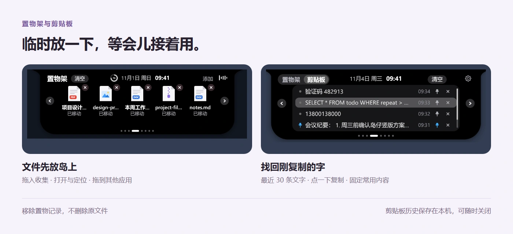
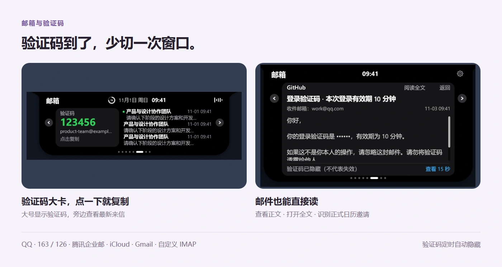
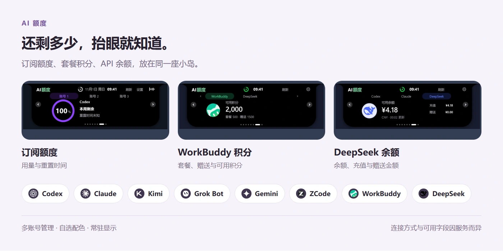
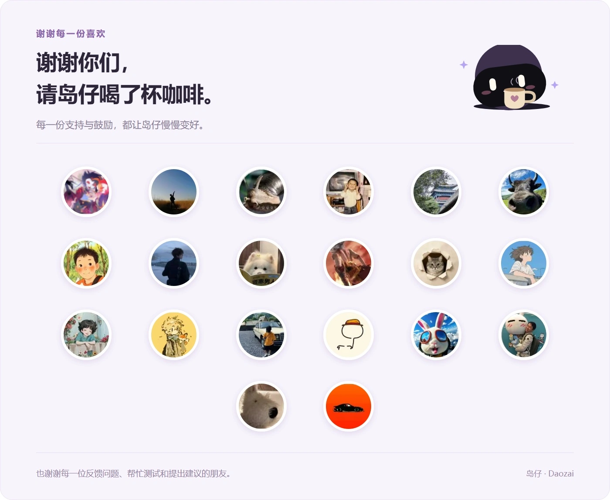

<div align="center">


# 岛仔 · Daozai

**一座小岛，装下桌面日常。**

Windows 桌面伙伴，把消息、音乐、日程和 AI 额度放到手边。

[](https://github.com/Renly1994/xiaotang-daozai/releases/latest)
[](#下载安装)
[](LICENSE)
[](#从源码构建与参与开发)

**[下载 Windows 版](https://github.com/Renly1994/xiaotang-daozai/releases/latest)** · [使用指南](docs/USAGE.md) · [更新记录](CHANGELOG.md) · [反馈问题](https://github.com/Renly1994/xiaotang-daozai/issues)

</div>

岛仔是一款开源的 Windows 桌面小工具。平时收起在屏幕边缘，鼠标靠近就展开；切歌、看日程、复制验证码、记一条待办，都能顺手完成。小岛里的伙伴会眨眼、打盹、喝水，也会跟着音乐唱歌。

你可以选刘海或胶囊，放在顶部、左侧或右侧，只保留自己需要的功能。岛仔使用 Rust 和 egui 构建，不依赖 Electron。

## 微信里有新消息，看一眼岛边



- **微信、QQ 未读提醒**：收起时亮起图标和红点，展开后在面板旁查看，点击切换到对应窗口。
- **微信多开分开看**：不同账号分别显示，点击对应账号的未读图标即可切换。
- **按需显示通知正文**：默认隐藏正文；开启预览后仍遮罩识别出的验证码。
- **微信提醒不读取聊天正文**：根据任务栏闪动提示新消息。微信缩在托盘时，可选开启「托盘一键唤起微信」。

开启方式：**设置 → 通知、邮箱与日程 → 通知**。微信开启「微信新消息提醒」；QQ 选择「只连接 QQ」，并在 QQ 中启用 Windows 系统通知。

## 换个皮肤，也换个位置



**五款皮肤 × 两种形态，自由搭配。** 经典黑、奶油、毛玻璃·浅、毛玻璃·深和「悬浮云」，都能搭配刘海或胶囊。毛玻璃透出身后的桌面；悬浮云随专辑封面换色，光晕跟着鼠标移动。



- **三边停靠**：顶部横向展开，左右侧边收起为竖向胶囊，靠近后从屏幕边缘展开。
- **大小与位置可调**：岛体大小支持 80%–140%；顶部可左右移动，侧边可上下调整。
- **多屏与自动避让**：跟随主屏或固定到指定显示器；指定应用覆盖小岛时，可自动收成贴边细线。
- **按习惯显示**：支持极简模式、12／24 小时制，以及功能页面开关与拖动排序。

在 **设置 → 常规 → 岛体外观／岛体显示** 中调整。岛上单行歌词目前支持顶部停靠。

## 听歌时，歌词就在抬眼处



播放、暂停、切歌、调节音量和拖动进度，都能在岛上操作。展开看歌词，也可以收起后只留一行歌词，让桌面继续做自己的事。

- 通过 Windows 媒体会话读取播放信息，并针对网易云音乐、QQ 音乐、酷狗、汽水音乐补充兼容。
- 网易云优先按歌曲 ID 找词，改善译名、合唱署名和 Live／Remix 等不同版本的匹配。

播放器需提供可用的媒体信息；歌词取决于歌曲元数据与歌词来源，个别歌曲或播放器版本可能无法显示。

## 日程、待办和专注，放在一起



| 想做的事 | 岛仔能帮你 |
| --- | --- |
| 看今天的安排 | 月历与当日时间线，合并多个日历和正式邮件邀请，提前提醒会议 |
| 记住每周的事 | 待办支持单次提醒、每周指定日期重复或每天重复；下一次到来时恢复为待办 |
| 专心做一件事 | 专注与休息计时，收起时也能查看进度 |
| 记得喝水 | 自定义每日目标、单次饮水量、提醒间隔与时段，记录错误可撤销 |

日历可接入 **飞书、钉钉、企业微信、iCloud、自定义 CalDAV 和兼容的 Exchange ActiveSync**，也能导入 `.ics` 文件。相同日程合并去重；支持全天、跨天和重复日程。

本机新建或导入的日程保存在本机；远程日历为只读同步。程序退出、电脑关机或睡眠期间无法持续提醒。

## 文件先放岛上，刚复制的字也能找回



**文件置物架**：拖入文件临时收集，点击打开、定位原文件，或拖出到其他应用。移除记录不会删除原文件。

**文字剪贴板**：找回最近复制的 30 条文字，点一下重新复制，常用内容可以固定。历史保存在本机，重启后仍可查看；可在 **设置 → 待办与置物 → 剪贴板** 中关闭。密码管理器标记为敏感的内容不记录。

## 验证码少切一次窗口，邮件也能直接读



连接多个邮箱，在岛上查看来信、识别验证码并点击复制。邮件支持正文阅读与独立全文窗口，网页链接交给默认浏览器打开；正式日历邀请可进入日程。支持已读／未读切换、全部已读、移到回收站及恢复；默认仅在本机整理，可在邮件设置中开启「同步邮件操作到邮箱」。

支持 **QQ、163、126、腾讯企业邮、iCloud、Gmail 和自定义 IMAP**。验证码可设置在 30／60／300 秒后自动隐藏，覆盖列表、正文与通知；主动查看后会再次隐藏。

## AI 还剩多少额度，抬眼就知道



支持 **Codex、Claude、Kimi、Grok Bot、Gemini、ZCode、WorkBuddy 和 DeepSeek**。

订阅额度、重置时间、套餐积分与 API 余额，按服务展示。多个账号可分别命名、选择配色，常用账号直接放在收起的小岛上。

- **ZCode**：查看套餐额度。
- **Claude**：只读取桌面版本地用量历史与缓存，或接收 Claude Code 官方状态栏输出；岛仔不使用 Claude 登录令牌，也不请求 Claude 额度接口。数据随官方客户端使用更新，桌面版缓存有效时自动显示重置时间，读取不到时显示未知。
- **WorkBuddy**：查看剩余积分；优先识别本机客户端登录，也可在默认浏览器完成授权。
- **DeepSeek**：使用 API Key 连接，查看账户余额、充值与赠送金额。

连接方式、可用字段与账号订阅有关；请求失败或登录过期时，以对应服务的官方页面为准。

## 还有这些顺手的小功能

电源与电量、网络变化、音量、大写锁定、输入语言、蓝牙设备状态，都能在小岛上提示。通知、蓝牙监听与不常用的功能页可以按需关闭。

## 下载安装

前往 **[最新正式版](https://github.com/Renly1994/xiaotang-daozai/releases/latest)**，按使用习惯选择：

| 下载文件 | 使用方式 |
| --- | --- |
| `Daozai-Setup-v版本号-x64.exe` | **推荐**。双击安装，可选择安装位置、桌面快捷方式和开机自启 |
| `Daozai-v版本号-windows-x64.zip` | 免安装。完整解压后运行 `daozai.exe`，用户数据仍保存在应用数据目录 |
| `SHA256SUMS.txt` | 下载校验，可用 PowerShell `Get-FileHash -Algorithm SHA256` 比对 |

首次安装默认创建桌面快捷方式、不开机自启。安装后从小岛或托盘打开设置，选择需要的功能和连接。

**更新**：设置 → 关于 → 检查更新。支持应用内下载、校验后重启更新，也可从发布页下载覆盖安装；升级保留原设置和数据，卸载同样保留用户数据。下载窗口提供夸克网盘备用入口。

**系统**：Windows 10／11 x64。默认使用 OpenGL，初始化失败时自动尝试 Direct3D 12。Windows 11 已进行本机实测，Windows 10、不同显卡及多屏组合仍需更多反馈。暂不提供 macOS、Linux 或 ARM64 成品包。

当前程序未做商业代码签名，Windows 可能提示未知发布者；请核对仓库来源与文件校验值。更多操作见 [使用指南](docs/USAGE.md)。

<details>
<summary><b>连接服务之前，需要准备什么？</b></summary>

| 类型 | 支持入口 | 需要准备 |
| --- | --- | --- |
| 邮箱 | QQ、163、126、腾讯企业邮、iCloud、Gmail、自定义 IMAP | 启用 IMAP，填写授权码或 App 专用密码；自定义服务可填写服务器、端口与登录用户名 |
| 日历 | 飞书、钉钉、企业微信、iCloud、CalDAV、Exchange ActiveSync | 服务商提供的日历同步凭据与必要的服务器地址；安装桌面客户端不等于授权 |
| AI 额度 | Codex、Claude、Kimi、Grok Bot、Gemini、ZCode、WorkBuddy、DeepSeek | 对应客户端登录、独立授权或 API Key；具体以设置中的连接入口为准 |

QQ 收信、邮件日程和飞书个人日历已进行真实账号测试。其他日历入口的可用性与服务端配置、权限和兼容性有关；钉钉、企业微信尚未完成本轮真实账号同步验收。

</details>

<details>
<summary><b>数据与隐私</b></summary>

- 设置、待办、本机日程、饮水记录、剪贴板历史、置物路径与连接元数据保存在 `%APPDATA%\Daozai`。
- 邮箱和日历密码、DeepSeek API Key 保存在 Windows 凭据管理器；独立 Gemini、WorkBuddy 会话使用 Windows DPAPI 加密。
- 微信新消息提醒根据任务栏闪动工作，不读取联系人或聊天正文；QQ 与应用通知需要相应的系统通知权限。
- 读取已有 AI 客户端登录时不回写原客户端配置。不要把授权码、Cookie、API Key 或登录 JSON 上传到 Issue。
- 邮箱读取收件箱，不读取垃圾邮件文件夹；邮件正文在当前进程中用于展示和识别。
- 岛仔没有自建的邮件或日程上传后台；开启联网功能后，会访问对应服务商与歌词服务。

完整说明见 [隐私与安全](docs/PRIVACY.md)。

</details>

<details>
<summary id="从源码构建与参与开发"><b>从源码构建与参与开发</b></summary>

需要 Rust stable、MSVC C++ 构建工具和 Windows SDK。

```powershell
rustup default stable-x86_64-pc-windows-msvc
cargo build --locked --release --bin daozai
.\target\release\daozai.exe
```

运行测试及打包：

```powershell
cargo test --locked --all-targets --features record -- --test-threads=1
powershell -NoProfile -ExecutionPolicy Bypass -File .\scripts\package.ps1
```

测试按单线程运行，以隔离使用进程环境变量的数据目录测试。低内存设备可设置 `$env:CARGO_BUILD_JOBS = "1"`。打包需要 NSIS 3，可通过 `-NsisCompiler` 指定 `makensis.exe`。

项目结构、界面预览与贡献方式见 [开发指南](CONTRIBUTING.md)。

</details>

## 开源与致谢

岛仔原创代码采用 [MIT License](LICENSE)。Rust 依赖、vendored 代码、第三方图标及品牌标识沿用各自的许可或权利声明；MIT 不授予服务商标使用权，也不代表官方合作或认证。详见 [第三方声明](THIRD_PARTY_NOTICES.txt) 和 [依赖说明](docs/DEPENDENCIES.md)。

「悬浮云」皮肤作者：啵（[@hanhb123](https://github.com/hanhb123)）。感谢 egui／eframe、Rust 社区，以及提供参考与素材的开源项目。

## 感谢支持



喜欢岛仔的话，欢迎点一个 **Star**，也可以在 **设置 → 关于 → 支持作者** 请岛仔喝杯咖啡。
